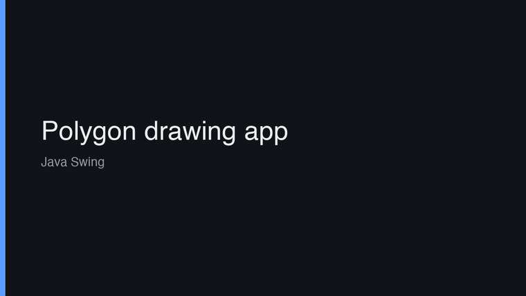
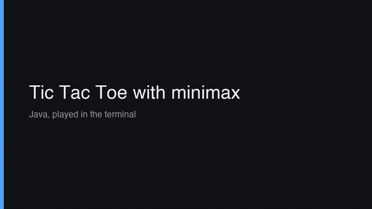
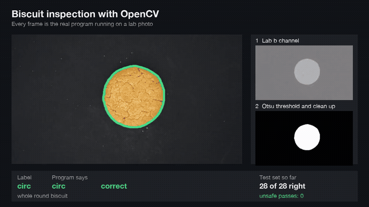
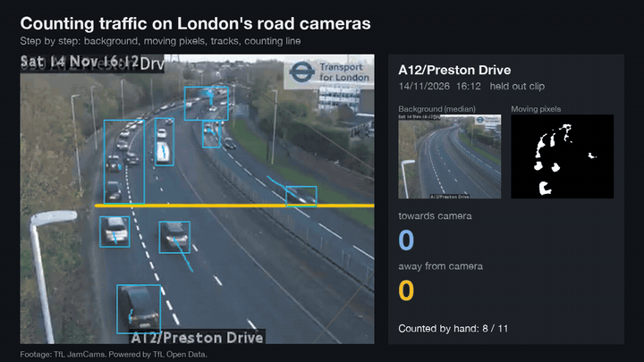
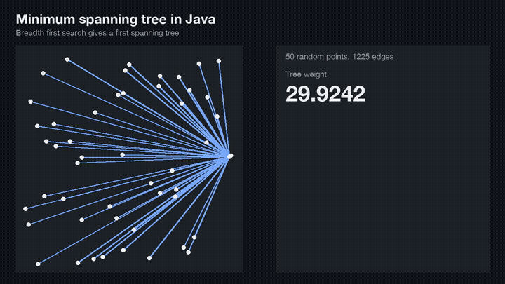
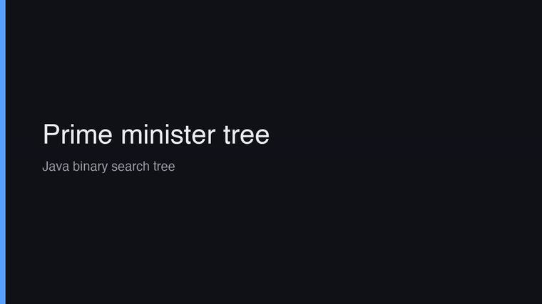
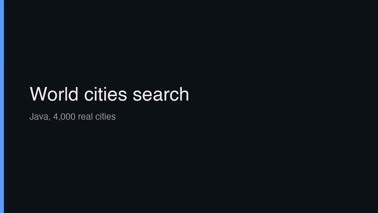
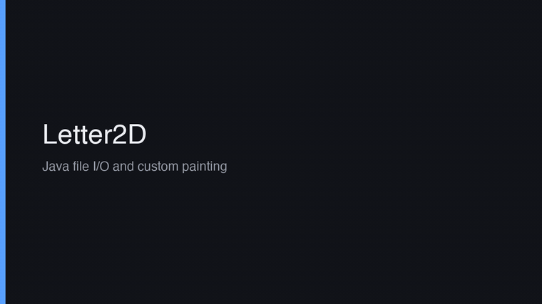
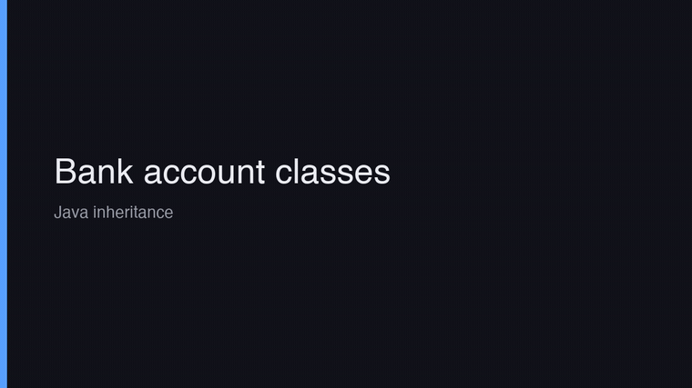
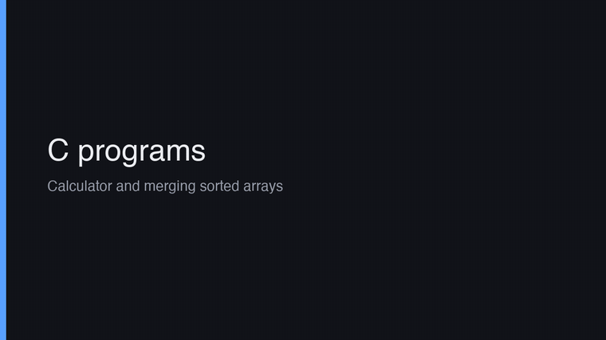

# Other Projects

Smaller things I built while learning MATLAB, Java, C and Python, kept in one place so they do not clutter the main repos. Each folder has its own short README.

- [MATLAB maths](matlab-maths): Symbolic maths, circuit voltages, Fourier series and plots. MATLAB.
- [Control theory in MATLAB](control-theory-matlab): State space, pole zero maps, step responses and a root locus. MATLAB.
- [Data structures](data-structures): A binary search tree of UK prime ministers with order statistics and deletion. Java.
- [Minimum spanning tree](minimum-spanning-tree): Built by swapping edges into a breadth first tree, then checked against Prim's algorithm. Java.
- [Biscuit inspection](biscuit-inspection): A camera check that sorts biscuit photos into round, rectangular or reject, with fail safe rules for overlapped and stacked biscuits. Python and OpenCV.
- [Car counter](https://github.com/MustafaKhodir/car-counter): Counts vehicles crossing a line on real Transport for London road cameras, split by direction and tested against my own hand count. Python and OpenCV.
- [Five in a row with minimax](tic-tac-toe-minimax): Five in a row on a 5 by 5 board against a minimax player with alpha beta pruning. Java.
- [Polygon drawing app](polygon-drawing-app): A Swing app for drawing, sorting and searching regular polygons. Java.
- [World cities app](world-cities-app): A population simulation and a search over 4,000 real cities. Java.
- [Bank account in Java](bank-account-java): A small inheritance example with checking and savings accounts. Java.
- [Letters in 2D](letter-2d-java): Random letters written to a file, read back and drawn in a window. Java.
- [C programs](c-programs): Merging sorted arrays, a grade calculator, a calculator and a mad libs game. C.

## Source code

The source code is private. Selected parts are available to employers for technical review. Contact me at [mkhodir77@gmail.com](mailto:mkhodir77@gmail.com).

## What's in this repo

- `outline/` outline files for the main programs: function names, structure and comments only. The working logic is in the private repository.

## Demo

Real runs of my Java and C programs, recorded straight from the code. MATLAB was not available for these recordings, so the MATLAB folders have a short write up only.

**Polygon drawing app.** The Swing window drawing six regular polygons from their side lengths.

**Tic Tac Toe with minimax.** A game against the alpha beta minimax player, which wins with five in a row along the top.

**Biscuit inspection.** The OpenCV checker running through the test photos with a live count of unsafe passes.

**Car counter.** The counter tracking vehicles on London road cameras and counting each one as it crosses the yellow line. Footage: TfL JamCams. Powered by TfL Open Data.

**Minimum spanning tree.** A breadth first spanning tree on 50 random points being improved one swap at a time until it matches Prim's algorithm.

**Prime minister tree.** The binary search tree finding the nth shortest tenure and listing the shortest serving prime ministers.

**World cities search.** The 10 largest cities, every city in the United Kingdom, and the 10 cities nearest London.

**Letter2D.** 100 random letters written to a file, read back and drawn in a window.

**Bank account classes.** Deposits, withdrawals and 30 years of compound interest.

**C programs.** The calculator and the sorted array merge.

All of them back to back with captions:

https://github.com/user-attachments/assets/fb265315-95c4-4dc7-a651-7931dacf88bb

The same video is in the repo as [other-projects-tour.mp4](media/demo/other-projects-tour.mp4) (82 s).

Copyright 2026 Mustafa Khodir. All rights reserved. Photos, videos and designs may not be reused without permission.
