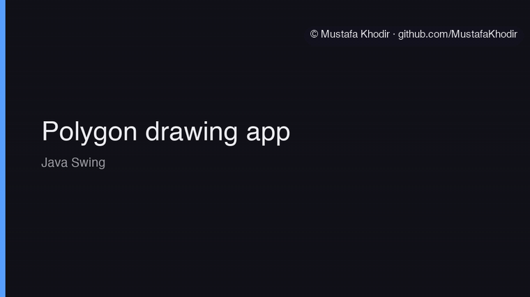
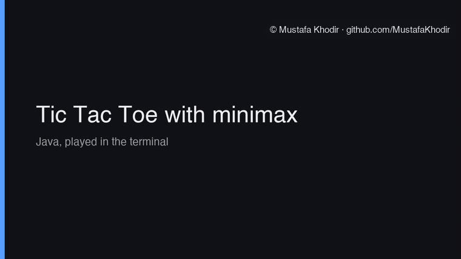
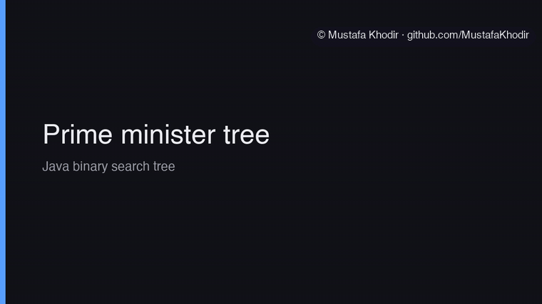
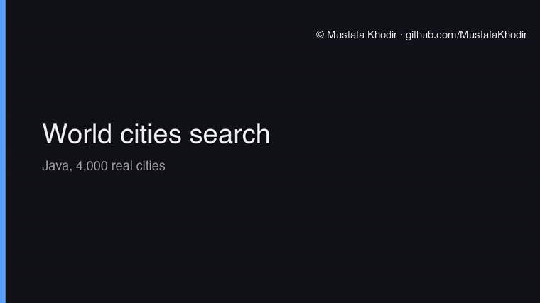
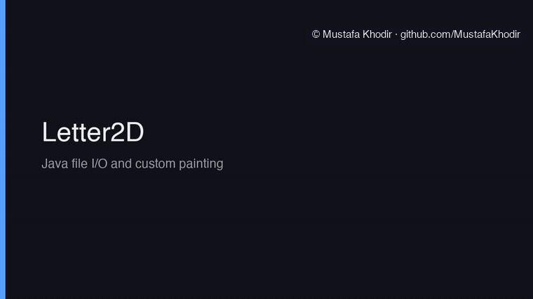
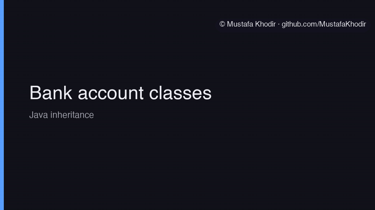
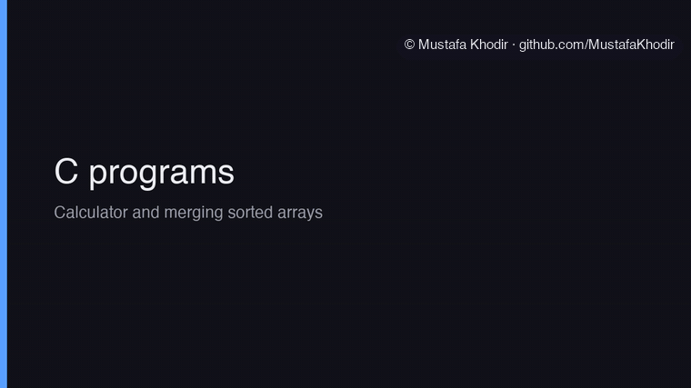

# Other Projects

Smaller things I built while learning MATLAB, Java and C, kept in one place so they do not clutter the main repos. Each folder has its own short README.

- [matlab-maths](matlab-maths) symbolic maths, circuit voltages, Fourier series and plots. MATLAB.
- [control-theory-matlab](control-theory-matlab) state space, pole zero maps, step responses and a root locus. MATLAB.
- [data-structures](data-structures) a binary search tree of UK prime ministers with order statistics and deletion. Java.
- [tic-tac-toe-minimax](tic-tac-toe-minimax) five in a row on a 5 by 5 board against a minimax player with alpha beta pruning. Java.
- [polygon-drawing-app](polygon-drawing-app) a Swing app for drawing, sorting and searching regular polygons. Java.
- [world-cities-app](world-cities-app) a population simulation and a search over 4,000 real cities. Java.
- [bank-account-java](bank-account-java) a small inheritance example with checking and savings accounts. Java.
- [letter-2d-java](letter-2d-java) random letters written to a file, read back and drawn in a window. Java.
- [c-programs](c-programs) merging sorted arrays, a grade calculator, a calculator and a mad libs game. C.

## Source code

The source code is private and available on request. Contact me at mkhodir77@gmail.com.

## Demo

Real runs of my Java and C programs, recorded straight from the code. MATLAB was not available for these recordings, so the MATLAB folders have a short write up only.

**Polygon drawing app.** The Swing window drawing six regular polygons from their side lengths.

**Tic Tac Toe with minimax.** A game against the alpha beta minimax player, which wins with five in a row along the top.

**Prime minister tree.** The binary search tree finding the nth shortest tenure and listing the shortest serving prime ministers.

**World cities search.** The 10 largest cities, every city in the United Kingdom, and the 10 cities nearest Bristol.

**Letter2D.** 100 random letters written to a file, read back and drawn in a window.

**Bank account classes.** Deposits, withdrawals and 30 years of compound interest.

**C programs.** The calculator and the sorted array merge.

All of them back to back with captions:

https://github.com/user-attachments/assets/5e43d212-4b99-4e39-9043-9e867d046c6d

The same video is in the repo as [other-projects-tour.mp4](media/demo/other-projects-tour.mp4) (82 s). Background music in the MP4 is a playful marimba track, synthesised from scratch for these demos and released as CC0.

Copyright 2026 Mustafa Khodir. All rights reserved.
