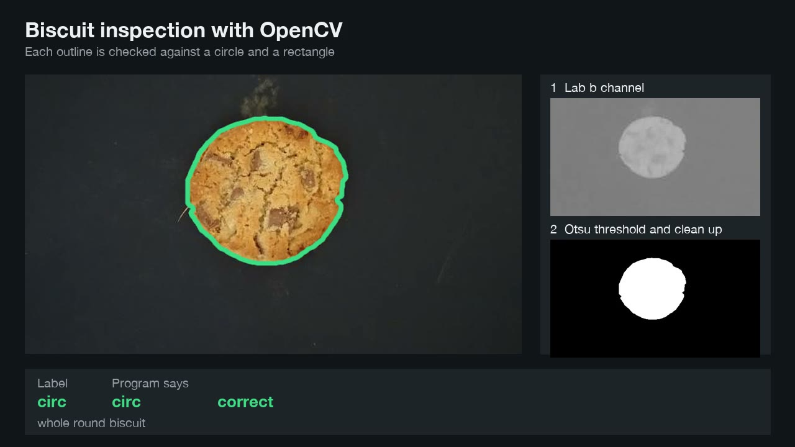
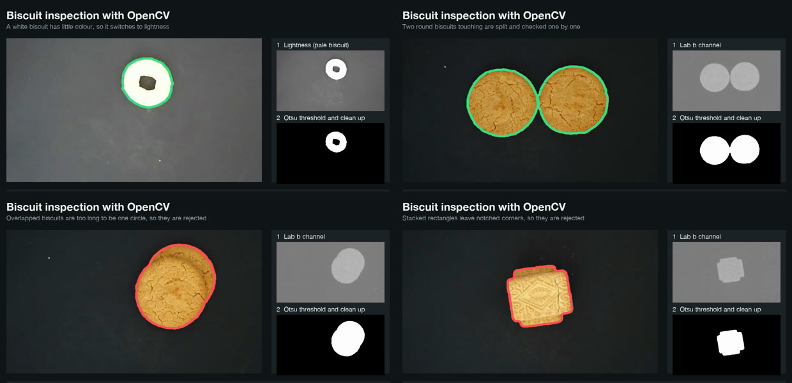
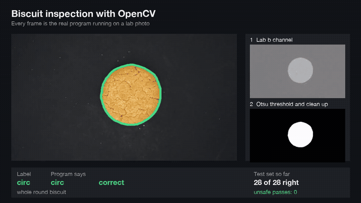

# Biscuit inspection with OpenCV

A Python and OpenCV program that looks at a photo of biscuits on a table and decides whether it shows whole round biscuits, whole rectangular biscuits, or something to reject: a broken biscuit, overlapping or stacked biscuits, or a mix. It is the kind of check a camera does over a production line, so it is built to fail safe. Language: Python, with OpenCV and NumPy.

## Results

On the 211 labelled test photos it gets **207 right (98%)** and **passes no bad photo**. The version I handed in for the computer vision lab got 3%: its fixed threshold failed on the grey, black and blue backgrounds, and most photos came out as round.

| Test set, 211 photos | Count |
| --- | --- |
| Right | 207 |
| Bad photo passed as good (unsafe) | 0 |
| Good photo rejected (safe, costs a biscuit) | 2 |
| Label file errors, where the program is right | 2 |

The thresholds were set by looking at the photos, so I also tested it fairly. The held out test used all 217 labelled photos: the 211 test photos plus the 6 training photos. Every threshold was chosen on the odd numbered photos and scored on the even ones, then the other way round. On photos the thresholds had never seen it got 107 of 109 and 102 of 108, about 96%, with one bad photo passed. That one is explained below.

## How it works

1. **Colour, not brightness.** The photo is converted to the Lab colour space and the b channel is kept. Biscuits are yellow and brown, so they sit high on b, while grey, black and blue tables sit low.
2. **A threshold per photo.** Otsu's method picks the threshold from each photo's own histogram instead of one fixed number.
3. **Clean up.** An opening removes crumbs and specks, a closing fills small gaps in the outline.
4. **Measure each outline.** For every object big enough to be a biscuit it measures how much of its smallest enclosing circle it fills, how much of its smallest rotated rectangle it fills, how solid it is against its convex hull, how long it is for its width, and how deep the notches in its edge go.
5. **Decide.** A photo passes only if every biscuit in it is clearly whole and of the same kind. Each result comes with a reason, for example "notched corners, looks stacked or broken", so an operator can see why a photo was rejected.

The output is in the lab's FACT format, one `result` line per photo, so it can be scored with the lab's tools.

## Safety: where it went wrong and how it is handled

There are two kinds of mistake, and they do not cost the same. Rejecting a good biscuit loses one biscuit. Passing a broken or stacked one sends a bad pack to a customer. So the rule is simple: **if the program is not sure, it rejects.** Before these changes it made 8 mistakes on the test set, and 2 of them were unsafe. Here is each one and what was done about it.

| Problem | What went wrong | How it is handled now | Result |
| --- | --- | --- | --- |
| Overlapped round biscuits (179) | Two cookies almost on top of each other still looked round enough, so they **passed** | A round biscuit must also be as wide as it is long, within 12%. Two overlapped circles are longer one way | Rejected, as it should be |
| Stacked rectangles (193) | Two custard creams slightly offset filled their rectangle well enough, so they **passed** | A rectangle must have clean corners. The offset leaves a step in the outline, measured as the deepest notch in the edge | Rejected, as it should be |
| White ring biscuits (056, 057) | White has almost no yellow, so the colour step only found part of the biscuit | If the colour contrast between biscuit and table is weak, it uses the lightness channel instead | Both now pass correctly |
| Two round biscuits touching (176) | Two circles side by side looked like one odd shape | An outline that fails is split with a distance transform and a watershed. It passes only if every half is a clean, round circle, so overlaps stay rejected | Now passes correctly |
| Thin bourbons (203, 204) | Their ridged edges look like notches, so the corner check rejects them | Left as a safe reject on purpose. Loosening the corner check would let stacked biscuits through | Still rejected, the safe way |
| Label file (190, 191) | Two rectangles side by side are labelled round in the lab's label file | Nothing to fix in the code. The program says rectangular, which is right | Counted as wrong by the scorer |

**What the held out test showed.** In one half of the split there was no stacked rectangle to learn from, so the corner limit was set too loose and photo 193 passed. A safety rule can only be tuned on examples of the failure it guards against. On a real line I would handle that by:

- collecting more photos of stacked and broken biscuits for every product before setting limits
- leaving a margin on the safe side of each limit rather than the tightest value that fits the data
- sending every reject to a check station, so a person confirms rejects and the false ones become new training photos
- adding a second view, such as a side camera, so a stacked pair shows its double height

## Demo

Every frame is the real program running on a lab photo. The bar at the bottom gives the label, the decision, the reason and a live count of unsafe passes:

The full 59 second run is [biscuit-inspection.mp4](../media/demo/biscuit-inspection.mp4). It shows the pipeline step by step, then the four hard cases, then all 211 test photos with every mistake held on screen, then the final count.

## What's in this folder

- [outline/biscuit-inspection/bikky.py](../outline/biscuit-inspection/bikky.py) the program with its structure, comments and function names. The working logic is in the private repository.
- the demo video and GIF in [media/demo](../media/demo), and the two stills in this folder.

The photos and the task file belong to the University of Essex computer vision module and are not included.

## Skills

OpenCV, colour spaces, Otsu thresholding, morphology, contour analysis, convexity defects, distance transform and watershed, fail safe design, honest evaluation with a held out split, Python.

## Source code

The source code is private. Selected parts are available to employers for technical review. Contact me at [mkhodir77@gmail.com](mailto:mkhodir77@gmail.com).

Copyright 2026 Mustafa Khodir. All rights reserved. Photos, videos and designs may not be reused without permission.
