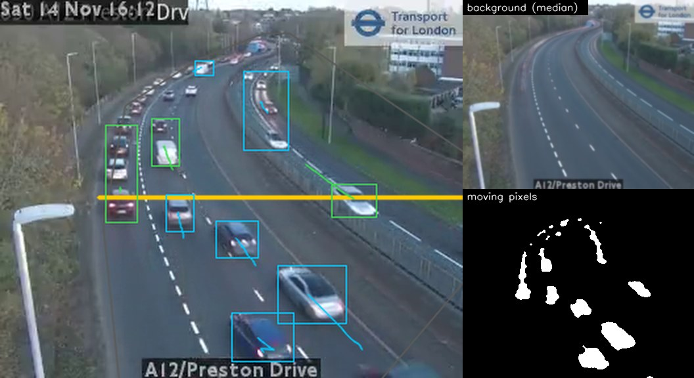
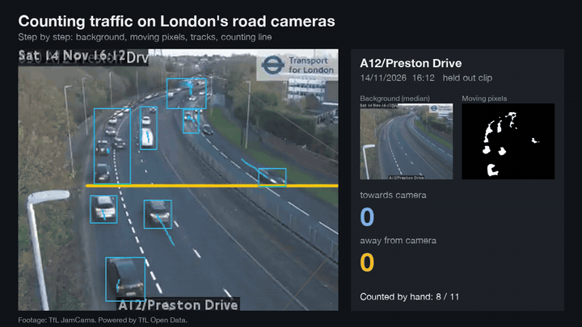

# Counting traffic on London's road cameras

A Python and OpenCV program that counts the vehicles crossing a line on a fixed traffic camera and splits the count by direction. It runs on real footage from Transport for London's JamCams, the public road cameras, which publish a 10 second clip from each camera every few minutes. Language: Python, with OpenCV and NumPy.

## Results

I recorded clips from four busy London roads on a Saturday afternoon in November and counted every vehicle by hand. The settings for each camera were tuned on the clips recorded before 16:05. The clips recorded after that were held out and never used to choose anything, so they are the fair test.

| Held out clips, 16:05 to sunset | Count |
| --- | --- |
| Clips | 5 |
| Vehicles counted by hand | 71 |
| Vehicles counted by the program | 63 |
| Off by vehicle and direction | 8 |
| Agreement | **89%** |
| Clips exactly right | 1 of 5 |

On the 8 tuning clips (99 vehicles) it matches the hand count exactly, but that only shows the tuning worked. The held out number is the one to quote.

| Camera | Held out clips | Hand | Program |
| --- | --- | --- | --- |
| A4 West of Sipson Road | 1 | 3 | 3 |
| A406 Angel Road East | 1 | 15 | 14 |
| A12 Preston Drive | 2 | 37 | 34 |
| A2 Arbuthnot Lane | 1 | 16 | 12 |

The program undercounts rather than overcounts. The errors are explained below.

## How it works

1. **Background.** Each clip is short and the camera does not move, so the background is the median of every second frame. Parked and queued traffic that does not move drops into the background.
2. **Moving pixels.** Each frame is compared with the background. Pixels that differ by more than a threshold, inside a hand drawn road area, are kept. An opening removes noise and a closing joins the parts of one vehicle into a single blob.
3. **Tracking.** Each blob is matched to the nearest track from the last frame, closest pairs first, with a limit on how far a vehicle can move between frames. A track that is not seen for a few frames is dropped.
4. **Counting.** A track is counted once, when its centre crosses the counting line. The side it ends up on gives the direction.

Each camera looks at a different road, so the road area, the counting line, the direction names and the tuned thresholds live in a small settings file, one entry per camera.

## How I counted by hand

Counting cars on a video by eye is easy to get wrong, so I made a line scan for each clip. It takes the raw pixels along the counting line in every frame and stacks them, one row per frame. Time runs down the image and every vehicle that crosses the line leaves one streak, and its position along the line tells the lane and so the direction. Where a streak was unclear, for example a car on the line in the first or last frame, I checked the frames themselves. A vehicle counts if its centre crosses the line inside the clip.

## Where it goes wrong

| Problem | What happens | How it is handled |
| --- | --- | --- |
| Cars side by side | On the A2 the cars are small and far away. Two cars in next door lanes can join into one blob and count as one | The A2 has a lower threshold, a smaller minimum size and a lighter closing than the nearer cameras. It still misses some, which is most of the held out error |
| Cars behind the caption | TfL prints the camera name over the bottom of every frame. On the A2 the nearest lane runs under it, so those cars are mostly hidden | Not fixed. The hand count includes them, so the program is marked wrong for each one it misses. A camera without the caption, or a counting line placed higher, would avoid it |
| Buses and lorries | A long vehicle can break into several blobs, and each blob can cross the line | A stronger closing on the near cameras keeps each vehicle in one piece. There is also a rule that ignores a second crossing right next to a recent one, which the tuning did not need |
| Corrupted frames | One A406 clip starts with 1.8 seconds of broken frames from the camera feed | The median background is not affected because most frames are clean. Vehicles in the broken part are not in the hand count |
| Queues | When traffic stops, stopped cars become part of the background and are not seen | Not handled. After sunset the A12 queued up, and those clips were left out of the test along with every other clip after sunset. Night clips also need different settings because headlights make the blobs too big |

## Demo

The counter on three of the clips. The yellow line is the counting line, blue boxes are tracked vehicles, and they turn green once counted:

The full run is [car-counter.mp4](../media/demo/car-counter.mp4). It shows the background and moving pixels, then three clips with the live count against my hand count, then the score on the held out clips.

## What's in this folder

- [outline/car-counter/counter.py](../outline/car-counter/counter.py) the counter with its structure, comments and function names. The working logic is in the private repository, along with the recorder, the line scan tool, the tuning and scoring scripts, the hand counts and the clips.
- the demo video and GIF in [media/demo](../media/demo), and the still in this folder.

## Footage

Footage: TfL JamCams. Powered by TfL Open Data. This project is not endorsed by Transport for London.

## Skills

OpenCV, background subtraction, morphology, blob detection, multi object tracking, line crossing counts, per camera tuning with a held out test, building ground truth by hand, Python.

## Source code

The source code is private. Selected parts are available to employers for technical review. Contact me at [mkhodir77@gmail.com](mailto:mkhodir77@gmail.com).

Copyright 2026 Mustafa Khodir. All rights reserved. Videos and designs may not be reused without permission. The camera footage belongs to Transport for London.
