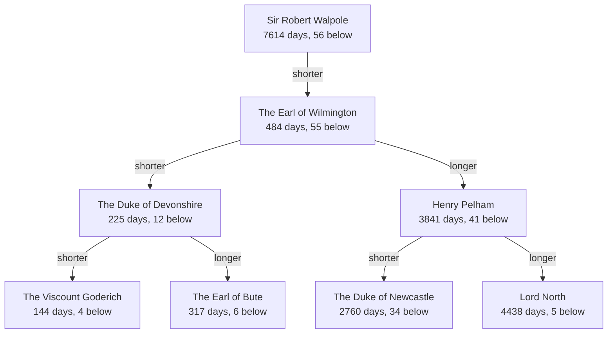

# Data structures: prime minister tree

A binary search tree of every UK prime minister keyed on days in office, where each node counts the nodes below it so "who is the nth shortest serving" is answered by walking a single path. It also deletes nodes with zero, one or two children and does an in order walk with an explicit stack. We were given a sample data file of prime ministers to build from. I wrote the tree and all the code around it. Language: Java.

The top four levels of the tree, built by running PMTree with the data file. Each box shows the prime minister, days in office and how many nodes sit below it:



Walpole is the root because the data starts with him, and he has nothing on his longer side because no one has served longer. Part of a real run:

```text
Number of prime ministers in the tree: 57
The 10th shortest serving prime minister is: { PM: The Lord Grenville, Days: 407, nodes below: 1 }
The 20th shortest serving prime minister is: { PM: Spencer Perceval, Days: 951, nodes below: 7 }
The 30th shortest serving prime minister is: { PM: The Earl Grey, Days: 1324, nodes below: 14 }
The 40th shortest serving prime minister is: { PM: Harold Macmillan, Days: 2471, nodes below: 0 }
The 50th shortest serving prime minister is: { PM: Henry Pelham, Days: 3841, nodes below: 41 }
```

The source code is private and available on request. Contact me at mkhodir77@gmail.com.
