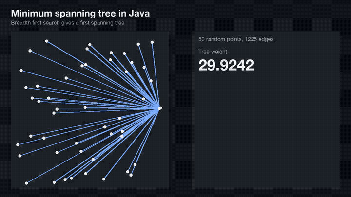

# Minimum spanning tree

A Java program that finds the minimum spanning tree of a weighted graph. It builds any spanning tree first with breadth first search, then tries every edge outside the tree: if that edge is lighter than the longest edge on the tree path between its two ends, the two are swapped. When no swap is left the tree is minimal. It is a simplified version of the idea behind Chazelle's MST algorithm. Language: Java.

This was a second year data structures and algorithms assignment. We were given the `Graph`, `MatrixGraph`, `Edge` and `GraphOfEssex` classes. The `MST` class is the work. The version I submitted in 2022 was unfinished: the spanning tree method returned nothing and the MST tests were commented out. This version completes it and passes every test in the brief.

What it does:

- adds up the total edge weight of a graph
- makes random graphs from points in a unit square, with the distance between points as the edge weight
- builds a spanning tree with breadth first search
- finds the longest edge on the path between two vertices of a tree, by recording where breadth first search reached each vertex from and walking back
- improves the tree one swap at a time until it is a minimum spanning tree

A real run on 50 random points. Blue is the current tree, red is the edge leaving, green is the edge coming in:



The full 50 second run, ending with the tests, is [minimum-spanning-tree.mp4](../media/demo/minimum-spanning-tree.mp4). It took 163 swaps to go from a tree of weight 29.58 to 4.888, and Prim's algorithm on the same points gives the same 4.888.

The tests from the brief, unedited output of `java MST`:

```text
Graph of Essex weight: 239.0 (expected 239)
MST of Graph of Essex weight: 95.0 (expected 95)
Average weight of 100 graphs: 637.30 (expected about 630 to 640)
Average weight of 100 graphs MST: 4.762 (expected about 4.80 to 4.84)
```

The graphs are random, so the last line moves a little each run. Over ten runs it ranged from 4.76 to 4.87 with a mean of 4.82. I also checked the result against Prim's algorithm on 500 random graphs of 2 to 61 vertices, and every one matched.

The source code is private. Selected parts are available to employers for technical review. Contact me at [mkhodir77@gmail.com](mailto:mkhodir77@gmail.com).

Copyright 2026 Mustafa Khodir. All rights reserved. Photos, videos and designs may not be reused without permission.
