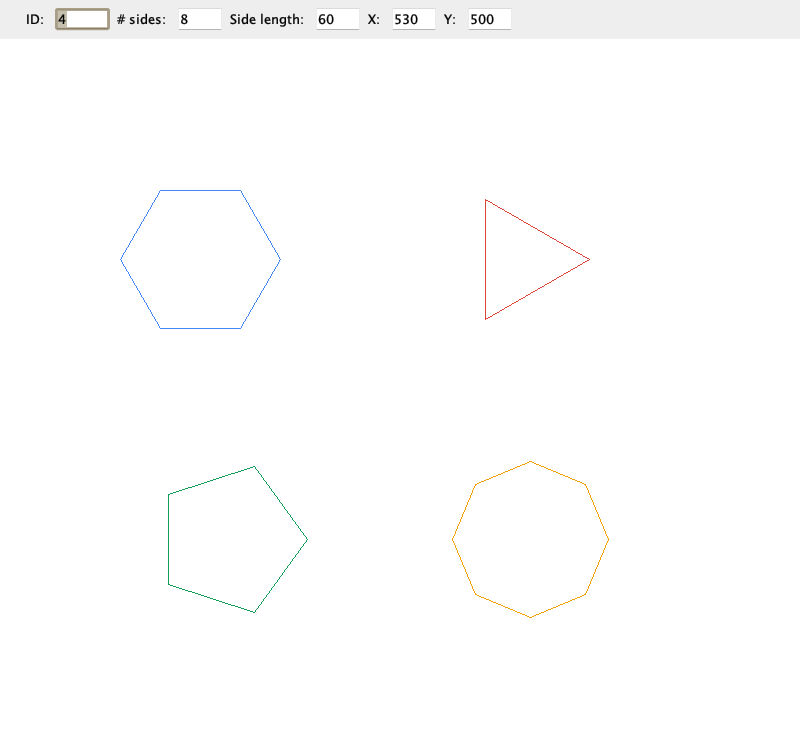

# Polygon drawing app

A Swing desktop app for drawing regular polygons: give each one an ID, a number of sides, a side length, a centre and a colour, or click the canvas to drop one there, then search by ID, sort, clear and redraw. The corners are worked out from the side length using the radius of the circle through them. Language: Java.

Captured from the running app with four polygons added through its own input fields. The buttons along the bottom are AWT buttons, which do not show up in an off screen capture.

The source code is private and available on request. Contact me at mkhodir77@gmail.com.
